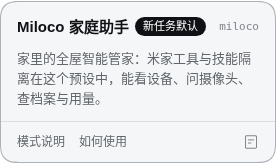
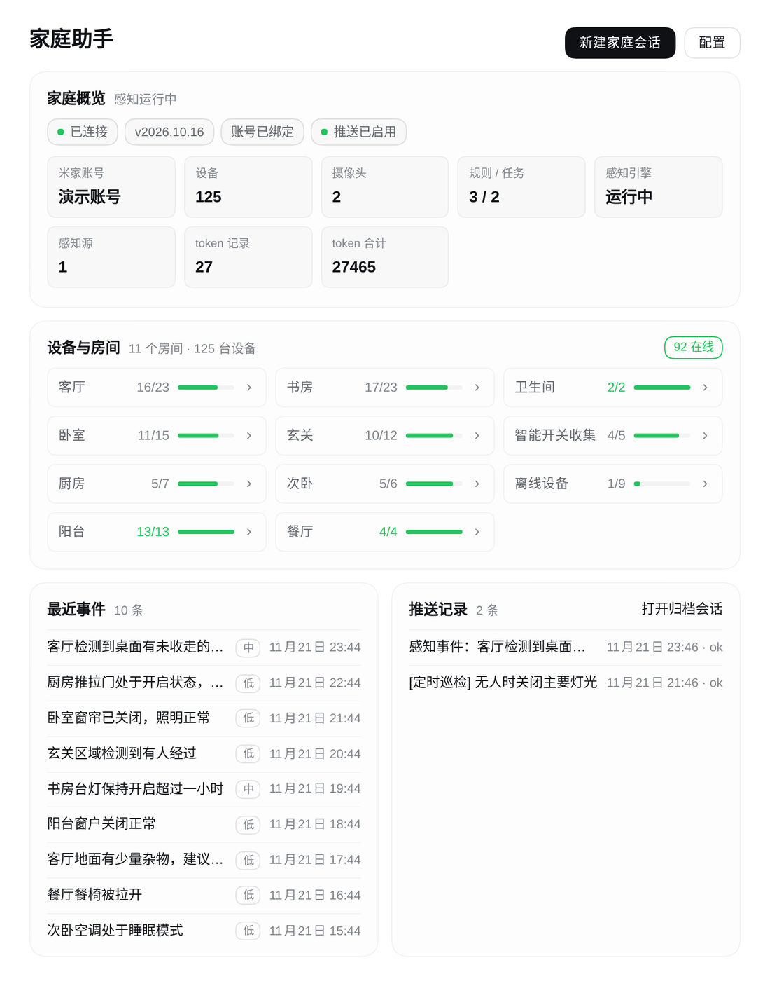
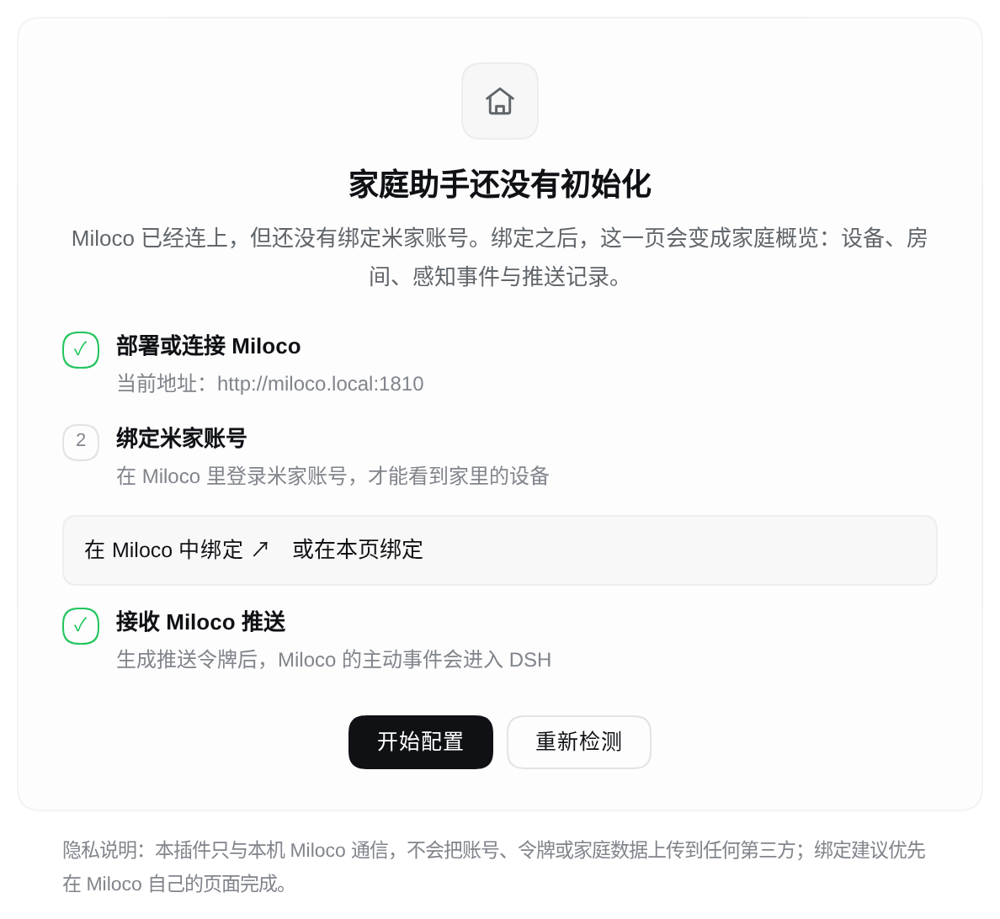
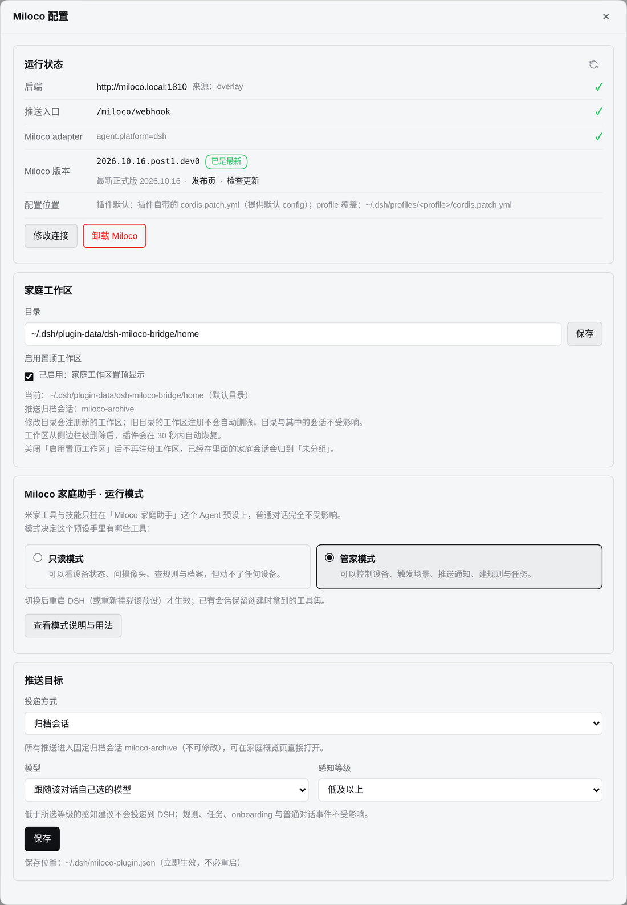

# dsh-miloco-bridge

**一个把 Xiaomi Miloco 接入 DeepSeek Harness (DSH) 的桥接插件：用专用 Agent 预设隔离 Miloco 产生的工具，避免干扰其他对话/项目，同时兼容 Miloco 的主动推送能力。**

[](https://www.npmjs.com/package/dsh-miloco-bridge)
[](LICENSE)
[](https://github.com/topics/dsh-plugin)

> 非官方项目，与小米无隶属关系；非网页版，是运行在 DSH Web profile 里的原生插件。
> Miloco 是独立项目，受其自身许可证约束，见 [NOTICE](NOTICE)。

## 截图

| Agent 预设 | 家庭概览页 | 初始化页 | Miloco 配置 |
|---|---|---|---|
|  |  |  |  |

> 截图使用演示数据；真实账号、内网地址与 token 用量已脱敏。
> 初始化页是「还没连上 Miloco」或「连上了但还没绑定米家账号」时看到的独立引导页，
> 与配好之后的家庭概览不是同一套版式。

## 它解决什么问题

- **Agent 隔离**：56 个 Miloco 工具和 18 个 Skill 只挂在专用预设「Miloco 家庭助手」上。
  普通对话看不到 `miloco_*` 工具，也不会被注入 Miloco 技能。
- **完整能力**：设备、场景、感知、规则、任务、身份、宠物、家庭档案、通知、token 用量。
- **推送闭环**：Miloco 的感知事件、规则触发、任务到期可以主动推送到 DSH 会话。
- **家庭概览**：侧栏「Miloco 家庭助手」打开家庭概览（账号、设备、摄像头、规则/任务、
  感知与 token 用量）、设备/房间、最近事件、推送记录与连接状态。
- **初始化引导**：没连上 Miloco、或连上了但还没绑定米家账号时，页面是一张独立的
  居中引导页（三步清单 + 绑定入口），不是配好之后的仪表盘；
  绑定可以直接跳到 Miloco 自己的页面，也可以在本页粘贴小米回调页的授权内容完成。
- **家庭工作区**：家庭工作区默认置顶显示，可在配置里修改目录、被误删后 30 秒内自动恢复；
  关闭「启用置顶工作区」后不再注册工作区，其中的会话归到「未分组」。
- **推送归档**：推送默认进入专用归档会话 `miloco-archive`，也可在配置里改为任意指定会话；
  会话内以折叠卡片展示，结构与 DSH 自动化任务触发卡片一致。
- **感知过滤**：按 `low / medium / high` 事件优先级过滤，低于阈值的感知建议不产生 DSH turn。
- **可视化配置**：家庭工作区目录、推送目标、感知等级、运行模式、连接与卸载，
  都在侧栏「Miloco 家庭助手」页面点「配置」完成。
- **可独立安装**：没有 Miloco 也能装插件；之后可在 UI 一键部署或连接已有实例。

## 安装

### 从 npm 安装（推荐）

```bash
dsh plugin --profile web add dsh-miloco-bridge
```

> npm 新包可能处于审核期；若上述命令暂时 404，请使用下面的源码安装。

### 源码安装（npm 审核期 / 未发布时）

```bash
dsh plugin --profile web add github:exa160/dsh-miloco-bridge
```

### 从 bundle / 本地安装

```bash
# 发布包
dsh plugin --profile web add file:dist/dsh-miloco-bridge-0.2.1.tgz

# 本地开发（link）
./install.sh --profile web
```

### Miloco 侧 adapter

如果已安装 Miloco，`install.sh` 会自动安装 adapter、写入连接与推送令牌。
手动步骤、systemd、升级与卸载见 [docs/INSTALL.md](docs/INSTALL.md)。

安装后重启 DSH：

```bash
systemctl --user restart dsh-web.service
```

## 快速开始

1. 打开 DSH WebUI → 侧栏「Miloco 家庭助手」。
   - 还没配置时看到的是初始化页：按三步走（部署或连接 Miloco → 绑定米家账号 → 启用推送）。
   - 点「开始配置」可打开配置弹窗；点「在 Miloco 中绑定 ↗」直接去 Miloco 自己的页面绑定账号。
2. 没有 Miloco：点「一键部署 Miloco」；已有实例：点「连接已有的 Miloco」。
3. 新建会话时选择 **「Miloco 家庭助手」**，或用概览页的「新建家庭会话」。
4. 在配置弹窗里选择运行模式（只读 / 管家）、推送会话、可选模型与感知等级，并可修改家庭工作区目录。
5. 想收 Miloco 主动推送时，确认 Miloco 的 `agent.platform=dsh`，并使用同一枚 Bearer token。

> 隐私：插件只与本机 Miloco 通信，不上传账号、令牌或家庭数据；绑定建议优先用 Miloco 自己的流程。

## 权限与风险

- 写入 `$DSH_HOME`（配置、状态、可选部署源码）和 `$MILOCO_HOME`（adapter）。
- 访问 Miloco HTTP API（默认 `127.0.0.1:1810`，也可配置局域网地址）。
- 「一键部署」会运行上游 Miloco 安装器，可能安装 Python 依赖并占用磁盘。
- **默认只读**：写工具不注册；切换到管家模式后才会暴露设备控制、规则/任务创建等能力。
- 插件不包含遥测，不内置任何账号或 token；推送入口无令牌时 fail closed。
- 绑定米家账号时，插件只把一次性授权码转交给本机 Miloco：不落日志、不回显浏览器，
  也不会把账号、令牌或家庭数据上传到任何第三方。
- **入站推送凭据**：DSH `0.2.3` 起 HTTP 路由默认要求凭据，插件把「推送令牌」注册为
  宿主凭据（非 owner 身份、仅限推送路由），令牌不入日志、不回显浏览器；宿主不支持时
  退回插件自带的 Bearer 校验。

## 兼容性

- DSH：`0.2.3-alpha.2` 实测通过；建议 `>= 0.2.2-rc.5`（`0.2.3` 起启用宿主凭据校验）。
- Node.js：`>= 22`（DSH `0.2.3` 自身要求 `>= 24.22.3`）。
- Miloco：2.0 HTTP API（`/api/*`，`/api/admin/status`、`/api/perception/*` 等）。
- 平台：Linux / macOS；Web profile（`dsh --profile web`）。

## 文档索引

| 文档 | 内容 |
|---|---|
| [docs/INSTALL.md](docs/INSTALL.md) | 安装、连接、adapter、systemd、升级/卸载、排错 |
| [docs/VERIFICATION.md](docs/VERIFICATION.md) | 离线测试、真实 DSH/Miloco 验证、推送与过滤验证 |
| [docs/ARCHITECTURE.md](docs/ARCHITECTURE.md) | 双半架构、路由、配置层、状态文件、推送协议 |
| [docs/SKILL-REWRITES.md](docs/SKILL-REWRITES.md) | 为什么重写 18 个 Skill、改了什么、合规边界 |
| [docs/TOOLS.md](docs/TOOLS.md) | 56 个工具的参数与语义 |
| [SECURITY.md](SECURITY.md) | 安全边界与漏洞报告 |

## 开发

```bash
npm test                 # 157 项测试
npm run selftest         # 离线自检
npm run verify:readonly  # 真实 Miloco 只读接口
npm run pack:bundle      # 生成 dist/*.tgz
./install.sh --check     # 安装环境检查
```

## DSH Plugin 市场信息

- 能力分类：**集成与连接**
- 安装命令：`dsh plugin --profile web add dsh-miloco-bridge`
- GitHub topic：`dsh-plugin`
- 许可证：MIT
- 插件导出：`apply(ctx)`；根目录包含 `package.json`

## 许可证

MIT。Xiaomi Miloco 的名称、接口与商标归小米所有；本仓库不包含上游源码、Skill 原文、
模型或面板资源。详见 [LICENSE](LICENSE) 与 [NOTICE](NOTICE)。
